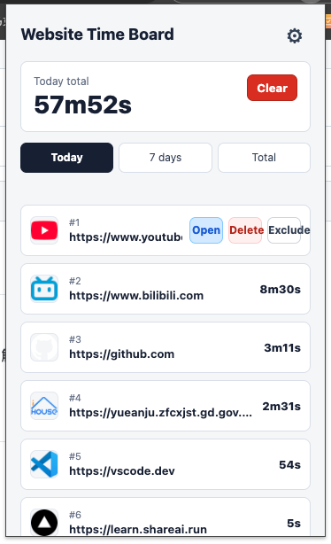
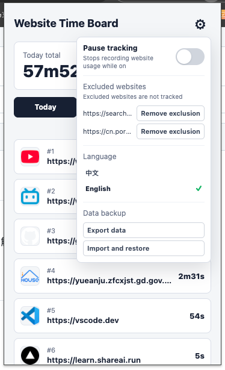

# Website Time Board

[简体中文](README.zh-CN.md)

Website Time Board is a lightweight Chrome/Chromium browser extension that tracks time spent on the currently active website and ranks sites by usage duration in a popup, helping you understand where your browsing time goes.

## Features

- View usage for **Today**, **7 days**, or **Total**
- Rank websites from the longest usage time to the shortest
- Show site icons, domains, and formatted durations
- Clear statistics for the selected range, or delete an individual website's records in that range
- Exclude websites from tracking, and remove exclusions in Settings
- Pause and resume website time tracking
- Export all data and restore it after reinstalling
- Switch between Chinese and English
- Store data locally in the browser without sending it to third-party services

## Screenshots

| Usage leaderboard | Settings panel |
| --- | --- |
|  |  |

## Installation (developer mode)

1. Download or clone this repository.
2. Open `chrome://extensions/` in Chrome, or the equivalent extensions page in Chromium.
3. Enable **Developer mode**.
4. Click **Load unpacked** and select the project root directory.
5. Browse a website for a while, then click the extension icon in the toolbar to view the statistics.

### Back up data before reinstalling

Before uninstalling and reinstalling the extension, open Settings from the top-right corner of the popup and click “Export data” to save a JSON backup. After reinstalling, click “Import and restore” and select that file to restore usage statistics, tracking pause state, language, and excluded websites.

## Local development

This is a native JavaScript browser extension, so no build step is required. After changing the source code, click the extension's reload button on the extensions management page.

Run the test suite:

```bash
npm test
```

## Project structure

```text
.
├── manifest.json                 # Manifest V3 configuration
├── src/
│   ├── background/               # Service worker, sessions, and local storage
│   ├── popup/                    # Popup UI, interactions, and i18n
│   └── shared/                   # Site normalization, sessions, and aggregation
├── _locales/                     # Chinese and English extension metadata
├── assets/                       # Extension icons and README screenshots
└── tests/                        # Node.js built-in tests
```

## Data and permissions

The extension uses these Chrome permissions for tracking:

- `tabs`: read information about the active tab
- `storage`: save usage data locally in the browser
- `idle`: detect whether the device is idle
- `alarms`: periodically refresh the active usage session

Usage data is stored in `chrome.storage.local`. The extension does not send browsing history or usage statistics to a remote server.

## License

This repository does not currently specify a license. If you plan to publish or redistribute it, consider adding an appropriate open-source license first.
