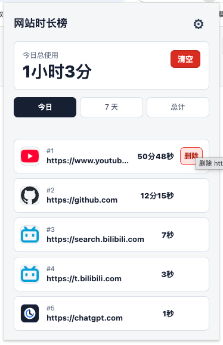
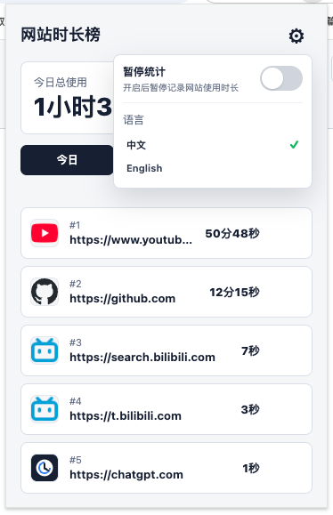

# Website Time Board / 网站时长榜

[中文](#中文) · [English](#english)

<a id="中文"></a>

## 中文

网站时长榜是一款轻量的 Chrome/Chromium 浏览器扩展，用于记录当前激活网站的使用时长，并在弹窗中按使用时长生成榜单，帮助你了解时间花在哪里。

### 功能

- 按「今日」「7 天」「总计」查看网站使用时长
- 按使用时长从高到低排列网站
- 显示网站图标、域名和格式化后的使用时间
- 一键清空当前范围的统计数据
- 删除某个网站在当前范围内的记录
- 暂停或恢复时长统计
- 中文 / English 界面切换
- 使用浏览器本地存储保存数据，不上传到第三方服务

### 界面预览

| 使用时长榜单 | 设置面板 |
| --- | --- |
|  |  |

### 安装（开发者模式）

1. 下载或克隆本项目。
2. 打开 Chrome 的 `chrome://extensions/`，或 Chromium 浏览器对应的扩展管理页面。
3. 开启右上角的「开发者模式」。
4. 点击「加载已解压的扩展程序」，选择本项目根目录。
5. 打开一个网页并使用一段时间，点击工具栏中的扩展图标即可查看统计结果。

### 本地开发

项目为原生 JavaScript 浏览器扩展，无需构建步骤。修改代码后，在扩展管理页面点击扩展卡片上的刷新按钮即可加载最新内容。

运行测试：

```bash
npm test
```

### 项目结构

```text
.
├── manifest.json                 # Manifest V3 配置
├── src/
│   ├── background/               # Service Worker、会话与本地存储
│   ├── popup/                    # 弹窗界面、交互与国际化
│   └── shared/                   # 网站归一化、会话和统计聚合逻辑
├── _locales/                     # 中文与英文扩展名称/描述
├── assets/                       # 扩展图标
├── assets/                       # 扩展图标与 README 截图
└── tests/                        # Node.js 内置测试
```

### 数据与权限

扩展使用以下 Chrome 权限完成统计：

- `tabs`：获取当前激活标签页的网站信息
- `storage`：在浏览器本地保存使用时长
- `idle`：识别设备是否处于空闲状态
- `alarms`：定期刷新当前使用会话

统计数据保存在 `chrome.storage.local` 中。扩展不会将浏览记录或统计数据发送到远程服务器。

### 许可证

当前仓库未指定许可证。如需公开发布或二次分发，建议先补充合适的开源许可证。

<a id="english"></a>

## English

Website Time Board is a lightweight Chrome/Chromium browser extension that tracks time spent on the currently active website and ranks sites by usage duration in a popup, helping you understand where your browsing time goes.

### Features

- View usage for **Today**, **7 days**, or **Total**
- Rank websites from the longest usage time to the shortest
- Show site icons, domains, and formatted durations
- Clear statistics for the selected time range
- Delete an individual website from the selected range
- Pause and resume time tracking
- Switch between Chinese and English
- Store data locally in the browser without sending it to third-party services

### Screenshots

| Usage leaderboard | Settings panel |
| --- | --- |
|  |  |

### Installation (developer mode)

1. Download or clone this repository.
2. Open `chrome://extensions/` in Chrome, or the equivalent extensions page in Chromium.
3. Enable **Developer mode**.
4. Click **Load unpacked** and select the project root directory.
5. Browse a website for a while, then click the extension icon in the toolbar to view the statistics.

### Local development

This is a native JavaScript browser extension, so no build step is required. After changing the source code, click the extension's reload button on the extensions management page.

Run the test suite:

```bash
npm test
```

### Project structure

```text
.
├── manifest.json                 # Manifest V3 configuration
├── src/
│   ├── background/               # Service worker, sessions, and local storage
│   ├── popup/                    # Popup UI, interactions, and i18n
│   └── shared/                   # Site normalization, sessions, and aggregation
├── _locales/                     # Chinese and English extension metadata
├── assets/                       # Extension icons
├── assets/                       # Extension icons and README screenshots
└── tests/                        # Node.js built-in tests
```

### Data and permissions

The extension uses these Chrome permissions for tracking:

- `tabs`: read information about the active tab
- `storage`: save usage data locally in the browser
- `idle`: detect whether the device is idle
- `alarms`: periodically refresh the active usage session

Usage data is stored in `chrome.storage.local`. The extension does not send browsing history or usage statistics to a remote server.

### License

This repository does not currently specify a license. If you plan to publish or redistribute it, consider adding an appropriate open-source license first.
