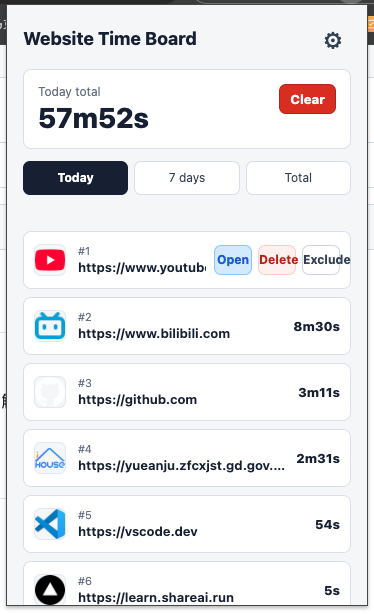
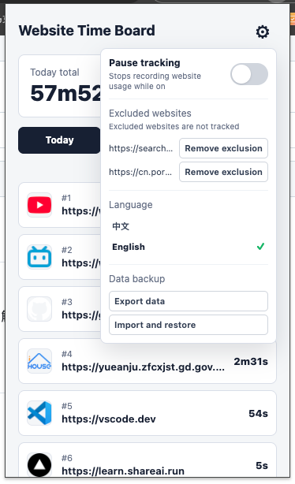

# Website Time Board

[简体中文](README.zh-CN.md)

Website Time Board is a lightweight Chrome/Chromium browser extension that tracks time spent on the currently active website and ranks sites by usage duration in a popup, helping you understand where your browsing time goes.

## Features

- View usage for **Today**, **7 days**, or **Total**
- Rank websites from the longest usage time to the shortest
- Show site icons, domains, and formatted durations
- Clear statistics for the selected range, or delete an individual website's records in that range
- Exclude websites from tracking, and remove exclusions in Settings
- Pause and resume website time tracking
- Read narrative weekly reports with total-time comparisons, website changes, the least-used day, and top three websites
- Customize weekly browser reminders and revisit saved reports anytime
- Export all data and restore it after reinstalling
- Switch between Chinese and English
- Store data locally in the browser without sending it to third-party services

## Screenshots

| Usage leaderboard | Settings panel |
| --- | --- |
|  |  |

## Installation (developer mode)

1. Download or clone this repository.
2. Open `chrome://extensions/` in Chrome, or the equivalent extensions page in Chromium.
3. Enable **Developer mode**.
4. Click **Load unpacked** and select the project root directory.
5. Browse a website for a while, then click the extension icon in the toolbar to view the statistics.

### Back up data before reinstalling

Before uninstalling and reinstalling the extension, open Settings from the top-right corner of the popup and click “Export data” to save a JSON backup. After reinstalling, click “Import and restore” and select that file to restore usage statistics, tracking pause state, language, excluded websites, weekly reminder settings, and saved reports. Exports use version 2; version 1 backups remain supported.

### Weekly reports and reminders

Click “View weekly reports” in the popup to choose a reminder day and local time, enable reminders, and save. The default is Sunday at 21:00, initially disabled. Each report covers the seven complete local days before the reminder date: a Sunday reminder covers the previous Sunday through Saturday. Empty periods are skipped; periods without previous usage do not show a change comparison.

Reports are local snapshots that can be reopened anytime. Clearing usage records or changing exclusions does not alter saved reports. Clicking a notification opens the matching report. Reminders may be delayed while the browser is closed or the device is asleep; reports are still saved if notifications are disabled. Reload the extension after updating and check notification permissions.

## Local development

This is a native JavaScript browser extension, so no build step is required. After changing the source code, click the extension's reload button on the extensions management page.

Run the test suite:

```bash
npm test
```

## Project structure

```text
.
├── manifest.json                 # Manifest V3 configuration
├── src/
│   ├── background/               # Service worker, sessions, and local storage
│   ├── popup/                    # Popup UI, interactions, and i18n
│   ├── reports/                  # Report history, details, and reminder settings
│   └── shared/                   # Site normalization, sessions, and aggregation
├── _locales/                     # Chinese and English extension metadata
├── assets/                       # Extension icons and README screenshots
└── tests/                        # Node.js built-in tests
```

## Data and permissions

The extension uses these Chrome permissions for tracking:

- `tabs`: read information about the active tab
- `storage`: save usage data locally in the browser
- `idle`: detect whether the device is idle
- `alarms`: periodically refresh active usage and schedule weekly reminders
- `notifications`: display weekly report notifications that open the matching report

Usage data is stored in `chrome.storage.local`. The extension does not send browsing history or usage statistics to a remote server.

## License

This repository does not currently specify a license. If you plan to publish or redistribute it, consider adding an appropriate open-source license first.
