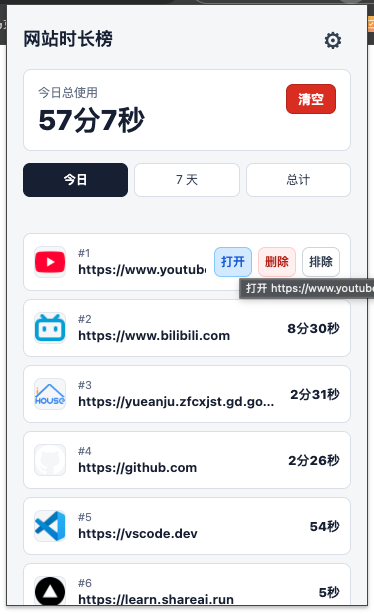
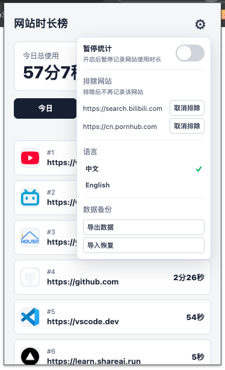

# 网站时长榜

[English](README.md)

网站时长榜是一款轻量的 Chrome/Chromium 浏览器扩展，用于记录当前激活网站的使用时长，并在弹窗中按使用时长生成榜单，帮助你了解时间花在哪里。

## 功能

- 按「今日」「7 天」「总计」查看网站使用时长
- 按使用时长从高到低排列网站
- 显示网站图标、域名和格式化后的使用时间
- 清空所选范围的统计数据，或删除某个网站在该范围内的记录
- 排除网站后不再统计该网站，也可在设置中取消排除
- 暂停或恢复网站时长统计
- 叙事周报：总时长对比、网站变化、使用最少的一天和前三网站
- 自定义每周浏览器提醒，随时回看已保存的历史周报
- 导出全部数据并在重新安装后导入恢复
- 中文 / English 界面切换
- 使用浏览器本地存储保存数据，不上传到第三方服务

## 界面预览

| 使用时长榜单 | 设置面板 |
| --- | --- |
|  |  |

## 安装（开发者模式）

1. 下载或克隆本项目。
2. 打开 Chrome 的 `chrome://extensions/`，或 Chromium 浏览器对应的扩展管理页面。
3. 开启右上角的「开发者模式」。
4. 点击「加载已解压的扩展程序」，选择本项目根目录。
5. 打开一个网页并使用一段时间，点击工具栏中的扩展图标即可查看统计结果。

### 重装前备份数据

如果要卸载并重新安装扩展，请先在弹窗右上角设置中点击「导出数据」，保存 JSON 备份文件。重新安装后打开设置，点击「导入恢复」并选择该文件，即可恢复网站使用统计、暂停状态、语言、排除网站设置、周报提醒与历史周报。新版导出采用版本 2，仍支持导入版本 1 的备份。

### 叙事周报与提醒

点击弹窗的「查看周报」，设置提醒开关、星期和本地时间，然后保存。默认时间为每周日 21:00，提醒初始关闭。每次提醒统计提醒日前 7 个完整日；例如周日提醒覆盖上周日至本周六，不含当天。没有使用记录时跳过该期，没有前期数据时不显示增减结论。

报告保存在本机，可在周报页面反复展开查看；后续清空原始记录或调整排除网站不会改变已保存的快照。点击浏览器通知可直接打开对应报告。浏览器关闭或设备休眠时提醒可能延后处理；即使通知被禁用，周报仍会保存。更新本版本后请在扩展管理页面重新加载扩展，并确认通知权限。

## 本地开发

项目为原生 JavaScript 浏览器扩展，无需构建步骤。修改代码后，在扩展管理页面点击扩展卡片上的刷新按钮即可加载最新内容。

运行测试：

```bash
npm test
```

## 项目结构

```text
.
├── manifest.json                 # Manifest V3 配置
├── src/
│   ├── background/               # Service Worker、会话与本地存储
│   ├── popup/                    # 弹窗界面、交互与国际化
│   ├── reports/                  # 周报历史、完整报告和提醒设置
│   └── shared/                   # 网站归一化、会话和统计聚合逻辑
├── _locales/                     # 中文与英文扩展名称/描述
├── assets/                       # 扩展图标与 README 截图
└── tests/                        # Node.js 内置测试
```

## 数据与权限

扩展使用以下 Chrome 权限完成统计：

- `tabs`：获取当前激活标签页的网站信息
- `storage`：在浏览器本地保存使用时长
- `idle`：识别设备是否处于空闲状态
- `alarms`：定期刷新当前使用会话，并调度每周提醒
- `notifications`：发送周报通知，点击后打开对应报告

统计数据保存在 `chrome.storage.local` 中。扩展不会将浏览记录或统计数据发送到远程服务器。

## 许可证

当前仓库未指定许可证。如需公开发布或二次分发，建议先补充合适的开源许可证。
